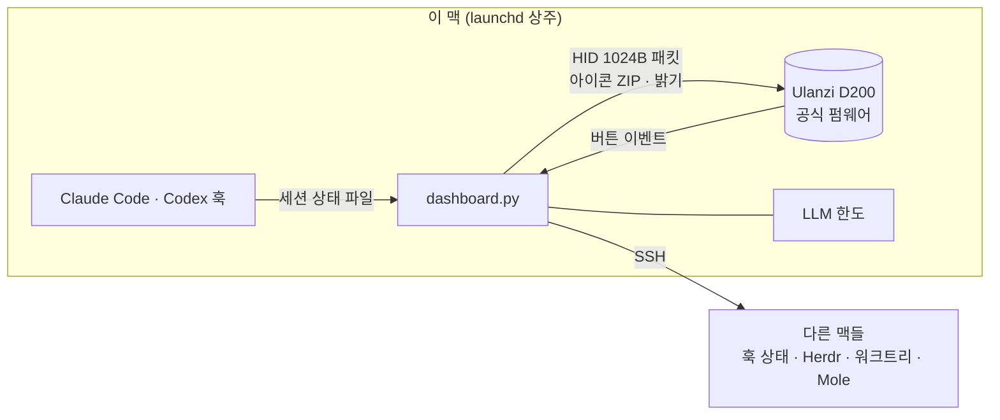

> 이 포크는 **Windows + Mirabox HSV293S (`6603:1014`)** 실행을 추가합니다.
> 설치·실행·지원 범위: **[Windows/Mirabox 가이드](docs/WINDOWS-MIRABOX.md)**.

<div align="center">


<p>
  <a href="LICENSE"></a>
  
  
  
  
  <a href="CONTRIBUTING.md"></a>
</p>

**AI 에이전트, LLM 한도, 맥 상태를 책상 위 13개의 버튼으로.**<br>
Ulanzi D200을 공식 앱 없이 직접 제어하는 macOS 대시보드

[English](README.en.md) · [日本語](README.ja.md) · [中文](README.zh-CN.md) · [사용 가이드](docs/GUIDE.md) · [기능](#-기능) · [빠른 시작](#-빠른-시작) · [기여하기](#-기여하기)

<br>


<a href="docs/video/agentdeck-intro.mp4"></a><br>
<sub>▶ 소개 영상 40초 (소리 있음) — 눌러서 보기</sub>

</div>

<br>

## ✨ 이런 분께 좋아요

- 여러 에이전트를 동시에 돌리면서 **"지금 누가 내 승인을 기다리지?"**를 자주 확인하는 분 → 결정이 필요한 칸이 **노랗게 깜빡이고**, 누르면 그 창으로 바로 이동해요.
- Claude, Codex, agy를 번갈아 쓰면서 **한도가 얼마나 남았는지** 궁금한 분 → 남은 한도와 소진 **페이스**, 지금 쓰기 좋은 LLM을 알려줘요.
- 여러 대의 맥을 굴리는 분 → 맥마다 CPU, 메모리, 디스크, 건강 점수를 보고 버튼으로 바로 정리해요.

> 💡 **펌웨어를 수정하지 않습니다.** 장치는 Ulanzi 공식 펌웨어 그대로이고, agentdeck은 **맥에서 도는 프로그램**이에요. 끄고 Ulanzi Studio를 켜면 원래대로 돌아갑니다.

## 🛒 준비물

- **Ulanzi Stream Controller D200**: [알리익스프레스 검색 결과](https://ko.aliexpress.com/w/wholesale-ulanzi-%EC%8A%A4%ED%8A%B8%EB%A6%BC%EB%8D%B1.html)에서 **최저가나 마음에 드는 판매처**를 골라 사면 돼요. [Ulanzi 공식 스토어](https://www.ulanzi.com/products/stream-deck-d200)도 있어요.
  - ⚠️ 상품명에 **D200**이 맞는지 꼭 확인하세요. 이름이 비슷한 **D200X**(노브 포함)와 **D200H**는 다른 모델이라 동작을 확인하지 않았어요.
- macOS(Apple Silicon), Python 3.11 이상

## 🧩 기능

> 기능별 설정 방법은 **[사용 가이드](docs/GUIDE.md)**에 그림과 함께 자세히 정리돼 있어요.

<table>
<tr>
<td width="50%" valign="top">

### 1 · LLM 남은 한도
Claude · Codex · agy의 **5시간 / 주간 남은 한도**(선택: Google Flow · Higgsfield 크레딧), 시간 대비 **페이스**(과속 / 적정 / 여유), 지금 쓰기 좋은 LLM, 다음 리셋

<sub>→ [가이드: LLM 한도](docs/GUIDE.md#41-llm-남은-한도-12페이지)</sub>

</td>
<td width="50%"></td>
</tr>
<tr>
<td></td>
<td valign="top">

### 3 · 에이전트 작업 현황
프로젝트별 에이전트 상태와 실행 수
- 🟨 결정 필요 · 🟩 완료 → **깜빡임**, 누르면 그 창으로 이동
- **VS Code, Cursor, iTerm, Ghostty, 터미널** 어디서 돌든 훅으로 수집
- [Herdr](https://herdr.dev) 사용자는 리드 pane 확대 같은 기능을 더 쓸 수 있어요

<sub>→ [가이드: 에이전트 현황](docs/GUIDE.md#42-에이전트-작업-현황-3페이지)</sub>

</td>
</tr>
<tr>
<td valign="top">

### 워크트리
git 워크트리를 **방치 · 정리 가능 · 오래됨 · 작업 중**으로 분류. 길게 두 번 누르면 머지된 워크트리를 삭제하거나 리드 에이전트에게 정리를 요청해요.

<sub>→ [가이드: 워크트리](docs/GUIDE.md#43-워크트리)</sub>

</td>
<td></td>
</tr>
<tr>
<td></td>
<td valign="top">

### 4 · 머신 · 기기 상세
여러 맥의 CPU · 메모리 · 디스크 · 외장 드라이브와 [Mole](https://github.com/tw93/Mole) **건강 점수**. 컴퓨터를 누르면 상세 페이지에서 **캐시 정리 · 빌드 산출물 정리 · 휴지통 비우기**를 할 수 있어요.

<sub>→ [가이드: 머신](docs/GUIDE.md#44-머신과-기기-상세-4페이지)</sub>

</td>
</tr>
<tr>
<td valign="top">

### 5 · 뽀모도로
칸 10개가 **마지막 칸부터 거꾸로** 비워지는 타이머. 끝나면 깜빡임과 맥 알림으로 알려줘요.

<sub>→ [가이드: 뽀모도로](docs/GUIDE.md#45-뽀모도로-5페이지)</sub>

</td>
<td></td>
</tr>
<tr>
<td></td>
<td valign="top">

### 6 · 주식 히트맵
[HeatTab](https://heattab.app)처럼 한국 주식을 등락률 색으로 보여줘요(상승 빨강 · 하락 파랑). **코스피·코스닥 상위, 업종 등락, 내 포트폴리오, 관심 업종, 환율·유가·금·금리**를 가운데 버튼으로 전환하고, 칸을 누르면 HeatTab 새 탭이 열려요.

<sub>→ [가이드: 주식 히트맵](docs/GUIDE.md#46-주식-히트맵-6페이지)</sub>

</td>
</tr>
<tr>
<td valign="top">

### 7 · 게임
위 10칸이 게임판이 돼요. **두더지 잡기**(30초, 황금 +3 · 폭탄 -3), 켜진 순서를 따라 누르는 **순서 기억**, 어항 친구들로 하는 **짝 맞추기**, STOP으로 릴을 멈추는 **슬롯머신**, 히트·스탠드·더블이 되는 **블랙잭**, 상대 패를 보며 컴퓨터와 붙는 **포커 대결**, 윗줄 다섯 칸을 이어 붙인 경주로에서 말 다섯 마리가 달리는 **경마**(단승·복승·쌍승·삼복승). 기록과 코인은 저장돼요.

<sub>→ [가이드: 게임](docs/GUIDE.md#47-게임-7페이지)</sub>

</td>
<td></td>
</tr>
<tr>
<td></td>
<td valign="top">

### 8 · 멍때리기 화면보호기
덱 전체를 하나의 화면으로 쓰는 **어항 · 불멍 · 비멍 · 바다** 네 장면과 어울리는 배경음. 어항에선 물고기·복어·해파리·게·거북이·문어·상어가 칸을 넘나들고, 칸을 누르면 먹이·장작·번개·큰 파도가 나와요. 한동안 안 쓰면 자동으로 켜지고, 알림이 오면 알아서 빠져나와요.

<sub>→ [가이드: 멍때리기](docs/GUIDE.md#48-멍때리기-화면보호기-어항--불멍--비멍--바다)</sub>

</td>
</tr>
</table>

## 🚀 빠른 시작

```bash
git clone https://github.com/jakeparkcolde/agentdeck.git
cd agentdeck
python3 -m venv .venv && .venv/bin/pip install -r requirements.txt
cp config.example.json config.json
.venv/bin/python dashboard.py            # Ulanzi Studio 는 먼저 종료!
```

| 다음 단계 | 명령 |
|---|---|
| 로그인할 때 자동 실행 | `./scripts/install-launchd.sh` |
| 에이전트 현황 켜기 (IDE·터미널 상관없음) | `python3 scripts/install-hooks.py` |
| 화면 언어 바꾸기 | 기본은 맥 시스템 언어(한국어면 한국어, 그 밖엔 영어). 고정하려면 `config.json`의 `"ui_lang": "ko"` 또는 `"en"` |

처음이라면 **[사용 가이드](docs/GUIDE.md)**를 따라 하세요. 준비부터 기능별 설정, 문제 해결까지 순서대로 정리돼 있어요.

## 🎛 조작

| 버튼 | 동작 |
|---|---|
| ◀ / ▶ | 페이지 이동 |
| 가운데 짧게 / 길게 | **홈**(바로가기 + 업데이트 내용)으로 · 갱신 / 밝기 변경 |
| 넓은 칸 2초 누르기 | 새 버전이 있으면 **업데이트 후 자동 재시작** |
| 깜빡이는 칸 | 해당 에이전트로 이동하고 알림 확인 |
| 🔴 삭제·정리 | **길게 1번 → 빨간 확인 대기 → 10초 안에 한 번 더 길게** |

## 🔧 동작 원리



- 버튼 13개 아이콘(196×196)과 넓은 칸(458×196) 이미지를 **ZIP으로 묶어** 한 번에 보내요. 아이콘 이름에 내용 해시를 써서 바뀐 칸만 다시 그려집니다.
- 프로토콜은 [redphx/strmdck](https://github.com/redphx/strmdck)와 [jcalado/companion-surface-d200](https://github.com/jcalado/companion-surface-d200)의 분석을 바탕으로 구현했어요.

> ⚠️ Codex 한도 조회는 **공식 문서가 없는 내부 API**를 씁니다. 언제든 바뀌거나 막힐 수 있으니, 각 서비스 약관을 확인하고 본인 책임 아래 사용하세요.

agy는 SSH로 공식 CLI의 읽기 전용 명령 `agy -p /usage --output-format json`을 실행해요(CLI 1.1.11 이상). 자세한 조건은 [Antigravity 한도 안내](docs/ANTIGRAVITY.md)를 보세요.

## 🗺 로드맵

- [x] 훅 방식 에이전트 수집 (VS Code · Cursor · 터미널)
- [x] 화면 문구 한국어 / 영어
- [ ] 일정 · 할 일 페이지 (다음 회의 카운트다운, 할 일 체크)
- [ ] PR / CI 상태 페이지
- [ ] 페이지 플러그인 구조 (코드 수정 없이 페이지 추가)

아이디어가 있으면 [기능 제안](https://github.com/jakeparkcolde/agentdeck/issues/new/choose)으로 알려주세요.

## 🤝 기여하기

새 페이지, 데이터 소스, 번역, 버그 제보 모두 환영해요. **장치가 없어도** `demo.py`로 화면을 그려보며 작업할 수 있어요.
자세한 방법은 **[CONTRIBUTING.md](CONTRIBUTING.md)**를 참고하세요.

## 🙏 크레딧

- D200 프로토콜: [redphx/strmdck](https://github.com/redphx/strmdck) (MIT) · [jcalado/companion-surface-d200](https://github.com/jcalado/companion-surface-d200)
- 맥 정리: [tw93/Mole](https://github.com/tw93/Mole) · 에이전트 터미널: [Herdr](https://herdr.dev)
- 배너 배경 이미지는 OpenAI Codex 이미지 생성으로 만들었어요.

agentdeck은 Ulanzi, Anthropic, OpenAI, Google과 관계없는 비공식 프로젝트입니다.

## 📄 라이선스

[MIT](LICENSE)
